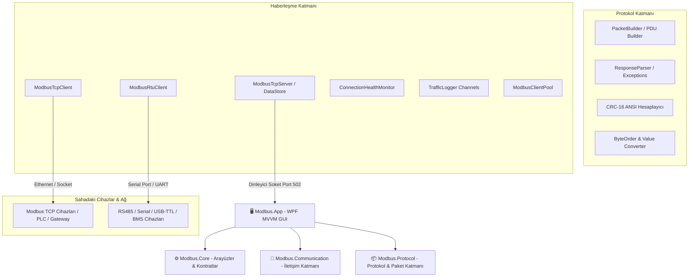

# ⚡ Modbus Communication Suite (MCS)

<div align="center">


<p align="center">
  <strong>Endüstriyel otomasyon sistemleri, PLC'ler, IoT ağ geçitleri ve gömülü cihazlar için geliştirilmiş; çift yönlü (Master/Slave), yüksek performanslı, asenkron Modbus haberleşme ve paket analiz paketi.</strong>
</p>

[Özellikler](#-öne-çıkan-özellikler) •
[Mimari](#-sistem-mimarisi) •
[Fonksiyon Kodları](#-desteklenen-modbus-fonksiyonları) •
[Gömülü Sistemler](#-gömülü-sistemler-ve-bms-mimarisi) •
[Kurulum](#-kurulum-ve-başlangıç) •
[Kullanım](#-kullanım-rehberi)

</div>

---

## 📌 Proje Genel Bakış

**Modbus Communication Suite (MCS)**, modern endüstriyel haberleşme gereksinimlerini karşılamak üzere **.NET 9** ve **WPF (MVVM)** mimarisi kullanılarak sıfırdan geliştirilmiş kapsamlı bir haberleşme ve analiz platformudur. 

Uygulama yalnızca bir Modbus Master (Client) olarak sahadaki cihazları izleyip yönetmekle kalmaz; aynı zamanda bünyesinde barındırdığı **Modbus TCP Server (Sanal Slave)** ile fiziksel donanıma ihtiyaç duymadan SCADA, HMI veya PLC yazılımlarını test edebileceğiniz bir simülasyon ortamı sunar.

> [!NOTE]
> Proje, saf soket ve seri port (`System.IO.Ports`) haberleşmesi üzerine inşa edilmiş olup, harici 3. parti Modbus kütüphanelerine bağımlı olmadan **Modbus Application Protocol Specification V1.1b3** ve **Modbus over Serial Line V1.02** standartlarına tam uyumludur.

---

## ✨ Öne Çıkan Özellikler

### 🔄 Çift Modlu Çalışma (Dual-Role Architecture)
- **Master (Client) Modu:** PLC, sensör, inverter ve BMS gibi sahadaki fiziksel Modbus kölelerine istek gönderin; verileri okuyun ve register'lara değer yazın.
- **Slave (Server) Modu:** Bilgisayarınızı sanal bir Modbus TCP cihazına dönüştürün. Dinlenecek portu belirleyin, register tablosundaki değerleri çalışma anında düzenleyin ve gelen istekleri anlık olarak izleyin.

### 🌐 Protokol ve Donanım Desteği
- **Modbus TCP/IP:** Standart Ethernet/IP ağı üzerinden MBAP (Modbus Application Protocol) header yapısı ile yüksek hızlı haberleşme.
- **Modbus RTU (Serial):** RS-485, RS-232 veya USB-to-TTL dönüştürücüler üzerinden COM port haberleşmesi. Donanımsal Baud Rate, Data Bits, Parity ve Stop Bits yapılandırması.
- **Standart Zamanlama Desteği:** Modbus V1.02 standardı uyarınca baud rate'e göre dinamik $t_{1.5}$ (karakter arası boşluk) ve $t_{3.5}$ (frame sonu boşluk) zamanlama kontrolleri.

### 🔍 Derinlemesine Paket Analizi (Deep Packet Inspector)
- Giden (**TX**) ve gelen (**RX**) tüm ADU/PDU paketlerinin bayt düzeyinde ayrıştırılması.
- Transaction ID, Protocol ID, Length, Unit ID, Function Code, Address, Data Payload ve CRC-16 alanlarının açıklamalı tablosu.
- Ham hex dökümü ve milisaniye hassasiyetli zaman damgaları.

### 📊 Çok Formatlı Register İzleme & Canlı Bellek Tablosu
- Register içeriklerini eşzamanlı olarak **Decimal**, **Hexadecimal (0x0000)** ve **16-bit Binary (`0000 0000 0000 0000`)** formatında görüntüleme.
- Slave modunda çift tıklama ile register değerlerini çalışma zamanında anında güncelleme.
- Otomatik zaman damgası takibi ile hangi verinin ne zaman güncellendiğini görme.

### ⚙️ İleri Seviye Veri Dönüşümü (Endianness / Byte Order Engine)
Farklı PLC ve işlemci mimarileri için tam byte ordering desteği:
- **ABCD:** Big-Endian (Standart Modbus formatı)
- **DCBA:** Little-Endian
- **BADC:** Mid-Big Endian (Byte Swap)
- **CDAB:** Mid-Little Endian (Word Swap)
- Float, Double, Int32, UInt32 ve 64-bit veri tiplerine kayıpsız dönüştürme.

### ⚡ Yüksek Performanslı Asenkron Trafik Loglama
- `System.Threading.Channels` tabanlı, UI iş parçacığını (UI thread) asla kilitlemeyen, yüksek frekanslı haberleşmelerde dahi sıfır bellek sızıntısıyla çalışan thread-safe loglama altyapısı.
- Milisaniye hassasiyetli TX/RX paket akış günlüğü ve tek tıkla log temizleme.

### 🩺 Bağlantı Sağlığı ve Havuz Yönetimi (Health Monitor & Connection Pooling)
- Periyodik ping/keep-alive sorguları ile kopan bağlantıları anında tespit etme ve otomatik yeniden bağlanma (Auto-reconnect).
- Çoklu cihaz yönetimi için optimize edilmiş `ModbusClientPool` mekanizması.

---

## 🏗️ Sistem Mimarisi

Proje, katmanlı mimari (Clean Layered Architecture) prensipleri ve MVVM (Model-View-ViewModel) tasarım deseni gözetilerek modüler bir şekilde inşa edilmiştir:



### 📂 Çözüm Dosya Yapısı

```text
ModbusCommunicationSuite/
├── Modbus.App/                       # WPF Arayüz Uygulaması
│   ├── Views/                        # RoleSelection, MasterView, SlaveView
│   ├── ViewModels/                   # MainViewModel, ViewModelBase
│   ├── Converters/                   # XAML Değer Dönüştürücüleri
│   ├── Helpers/ & Themes/            # Modern UI Bileşenleri & Stiller
│   └── App.xaml                      # Uygulama Başlangıç Noktası
│
├── Modbus.Core/                      # Temel Kontratlar & Arayüzler
│   └── Interfaces/                   # IModbusClient, IModbusClientAdvanced
│
├── Modbus.Protocol/                  # Modbus Protokol Motoru
│   ├── Builders/                     # Modbus PDU/ADU Paket Üreticileri
│   ├── Parsers/                      # Cevap Ayrıştırıcılar & Modbus Hata Kodları
│   ├── Converters/                   # ByteOrderConverter (Endianness), ValueConverter
│   ├── Functions/                    # Modbus Fonksiyon Kodu Tanımları
│   └── Helpers/                      # CRC-16 ANSI (Polynomial: 0xA001) Algoritması
│
├── Modbus.Communication/             # Ağ ve Seri Port Katmanı
│   ├── TCP/                          # ModbusTcpClient & Ayarlar
│   ├── RTU/                          # ModbusRtuClient, RS485/Serial Yönetimi & Ayarlar
│   ├── Server/                       # ModbusTcpServer & ModbusDataStore (Sanal Slave)
│   └── Services/                     # TrafficLogger, HealthMonitor, ClientPool
│
├── Modbus.Devices/                   # Cihaz Tanımlamaları ve Cihaz Profilleri
│
└── src/
    ├── ModbusSuite.Core/             # Veri Analizi, Trend Hesaplama & Alarm Yönetimi
    └── ModbusCommunicationSuite.Tests/ # Kapsamlı xUnit Birim Test Paketi
```

---

## 📖 Desteklenen Modbus Fonksiyonları

Standart endüstriyel haberleşmede kullanılan 8 temel fonksiyon kodu eksiksiz olarak desteklenmektedir:

| Kod (HEX) | Fonksiyon Adı | Erişim Türü | Açıklama |
|:---:|:---|:---:|:---|
| **`0x01`** | **Read Coils** | Bit (Okuma) | 1-bit dijital çıkış rölelerinin durumunu okur |
| **`0x02`** | **Read Discrete Inputs** | Bit (Salt Okunur) | 1-bit dijital girişlerin (sensör/switch) durumunu okur |
| **`0x03`** | **Read Holding Registers** | 16-Bit Word (Okuma/Yazma) | Cihaz konfigürasyon ve veri tutma yazmaçlarını okur |
| **`0x04`** | **Read Input Registers** | 16-Bit Word (Salt Okunur) | Ölçülen analog giriş verilerini okur (sıcaklık, basınç vb.) |
| **`0x05`** | **Write Single Coil** | Bit (Yazma) | Tek bir röle/bobin çıkışını ON/OFF (`0xFF00`/`0x0000`) yapar |
| **`0x06`** | **Write Single Register** | 16-Bit Word (Yazma) | Belirtilen holding register adresine tek bir 16-bit değer yazar |
| **`0x0F`** | **Write Multiple Coils (FC15)** | Çoklu Bit (Yazma) | Ardışık birden fazla röle/bobini tek istekte günceller |
| **`0x10`** | **Write Multiple Registers (FC16)** | Çoklu 16-Bit (Yazma) | Ardışık birden fazla register'a blok veri yazar |

---

## 🔍 Modbus Paket Yapısı ve İncelemesi

Uygulamanın bünyesindeki analiz paneli, gönderilen ve alınan paketleri standart protokol katmanlarına ayırır:

### Modbus TCP (ADU = MBAP Header + PDU)
```
┌───────────────────────────────── MBAP Header ─────────────────────────────────┐┌─────────── PDU ───────────┐
│ Transaction ID (2B) │ Protocol ID (2B) │ Length (2B) │ Unit ID / Slave (1B) ││ Func Code (1B) │ Data (nB) │
└─────────────────────┴──────────────────┴─────────────┴──────────────────────┘└────────────────┴───────────┘
```

### Modbus RTU (ADU = Slave Address + PDU + CRC16)
```
┌──────────────────┬───────────────── PDU ─────────────────┬──────────────────┐
│ Slave Addr (1B)  │  Function Code (1B)  │   Data (n Bytes)   │  CRC-16 (2 Bytes)│
└──────────────────┴──────────────────────┴────────────────────┴──────────────────┘
```

---

## 🔬 Gömülü Sistemler ve BMS Mimarisi

Proje, sadece masaüstü C# yazılımı ile sınırlı kalmayıp; **STM32 mikrodenetleyiciler** (örn. *NUCLEO-WB55RG Cortex-M4*) ve **FreeRTOS** ile çalışan donanımlarla uçtan uca haberleşecek şekilde modellenmiştir.

### 1. Kütüphane Yazılım Mantığı (`Init` / `Control` / `Callback`)
Gömülü kütüphane tasarımlarında uygulanan disiplin:
```text
Init()     ──► Handle belleğini hazırlar, donanımı başlatır, asla cihazı çalıştırmaz.
Start()    ──► Gerçek iletişimi/görevi tetikler.
Control()  ──► Non-blocking state machine'i yürütür, timeout ve retry kontrolü yapar.
Callback() ──► ISR/DMA tarafından çağrılır, sadece flag/event set eder, ağır işlem yapmaz.
```

### 2. STM32 BMS (Batarya Yönetim Sistemi) Entegrasyonu
- **NUCLEO-WB55RG** kartı üzerinde çalışan BMS Simülatörü, hücre voltajları, akım, SoC (State of Charge), sıcaklık ve alarm register'larını RAM'de üretir.
- **USB-to-TTL / RS485** üzerinden bu WPF uygulaması Master olarak bağlanır; batarya paketinin tüm hücre verilerini ve durum register'larını anlık olarak sorgular.

---

## 🚀 Kurulum ve Başlangıç

### Sistem Gereksinimleri
- **İşletim Sistemi:** Windows 10 / 11 (64-bit)
- **Çalışma Zamanı / SDK:** [.NET 9.0 SDK](https://dotnet.microsoft.com/download/dotnet/9.0) veya üzeri
- **Geliştirme Ortamı (Önerilen):** Visual Studio 2022 (v17.12+) veya Visual Studio Code (C# Dev Kit eklentisi ile)

### 📥 Depoyu Klonlama ve Derleme

```bash
# 1. Depoyu klonlayın
git clone https://github.com/AliFurkanOZ/modbus.git
cd modbus/ModbusCommunicationSuite

# 2. Bağımlılıkları geri yükleyin
dotnet restore

# 3. Projeyi derleyin
dotnet build -c Release

# 4. Uygulamayı çalıştırın
dotnet run --project Modbus.App/Modbus.App.csproj
```

---

## 🖥️ Kullanım Rehberi

### 1️⃣ Mod Seçimi
Uygulama açıldığında modern rol seçim ekranı karşılar:
- **Master Modu:** Fiziksel veya harici bir Modbus slave cihazına bağlanmak için.
- **Slave Modu:** Bilgisayarda sanal bir Modbus TCP sunucusu açmak için.

### 2️⃣ Master Modunda İstek Gönderme
1. Sol panelden haberleşme türünü seçin (**Modbus TCP/IP** veya **Modbus RTU**).
2. TCP için `IP Adresi` ve `Port` (varsayılan: 502); RTU için `COM Port` ve `Baud Rate` değerlerini girin.
3. **"Bağlan"** butonuna basın. Durum rozeti yeşile (`Bağlandı`) dönecektir.
4. İstek kartından **Function Code** (örn. `03 — Read Holding Registers`), **Başlangıç Adresi** ve **Miktar** belirleyin.
5. **"İstek Gönder"** butonuna basarak verileri okuyun.
6. Sağ panelde hem register tablosunu (Decimal, Hex, Binary) hem de alt kısımda bayt düzeyinde paket alanlarını anında inceleyin.

### 3️⃣ Slave (Sanal Cihaz) Modunda Çalışma
1. Dinleme portunu belirleyin (örn: `502`).
2. **"Sunucuyu Başlat"** butonuna basın.
3. PLC, HMI veya başka bir Modbus Master yazılımını bu IP ve porta yönlendirin.
4. **Server Register Hafızası** tablosundaki herhangi bir hücreye çift tıklayarak değeri değiştirin; bağlanan Master cihazın güncel veriyi anında okuduğunu doğrulayın.

---

## 📦 Paket ve Kütüphane Bağımlılıkları

| Paket | Versiyon | Görev |
|:---|:---:|:---|
| **`System.IO.Ports`** | `9.0.0` | Donanımsal Seri Port (COM, RS485, USB-TTL) haberleşmesi |
| **`System.Threading.Channels`** | `9.0.0` | Yüksek hızlı, thread-safe, non-blocking asenkron log kuyruğu |
| **`xUnit`** | `2.7.0` | Protokol ve mimari katmanları birim testleri |
| **`Moq`** | `4.20.70` | İletişim arayüzleri ve sahte donanım mock nesneleri |

---

## 🗺️ Yol Haritası (Roadmap)

- [x] Modbus TCP/IP İstemci ve Sunucu Desteği
- [x] Modbus RTU Seri Port ve CRC16 ANSI Doğrulama
- [x] Temel 8 Modbus Fonksiyon Kodunun Uygulanması
- [x] Ayrıntılı Paket Ayrıştırıcı (PDU/ADU Packet Inspector)
- [x] WPF Modern Arayüz (Rol Seçimli MVVM)
- [x] STM32 BMS Simülasyon Planı ve Mimarisi
- [ ] Modbus ASCII Protokol Desteği
- [ ] CSV / Excel Formatında Otomatik Veri Kaydı (Data Logging)
- [ ] Dinamik Grafik ve Trend Çizici Bileşeni
- [ ] Modbus RTU Over TCP (Encapsulated) Desteği

---

## 🤝 Katkıda Bulunma

Projeye katkıda bulunmaktan mutluluk duyarız!
1. Depoyu Fork'layın (`Fork` butonuna basın)
2. Yeni bir özellik dalı oluşturun (`git checkout -b feature/YeniOzellik`)
3. Değişikliklerinizi commit'leyin (`git commit -m 'feat: Yeni özellik eklendi'`)
4. Dalınıza push yapın (`git push origin feature/YeniOzellik`)
5. Bir **Pull Request** açın

---

## 📄 Lisans

Bu proje [MIT Lisansı](LICENSE) kapsamında lisanslanmıştır. Detaylar için lisans dosyasına göz atabilirsiniz.

---

<div align="center">
  Geliştirici: <strong>Ali Furkan ÖZ</strong> • <a href="https://github.com/AliFurkanOZ/modbus">GitHub Deposu</a>
</div>
